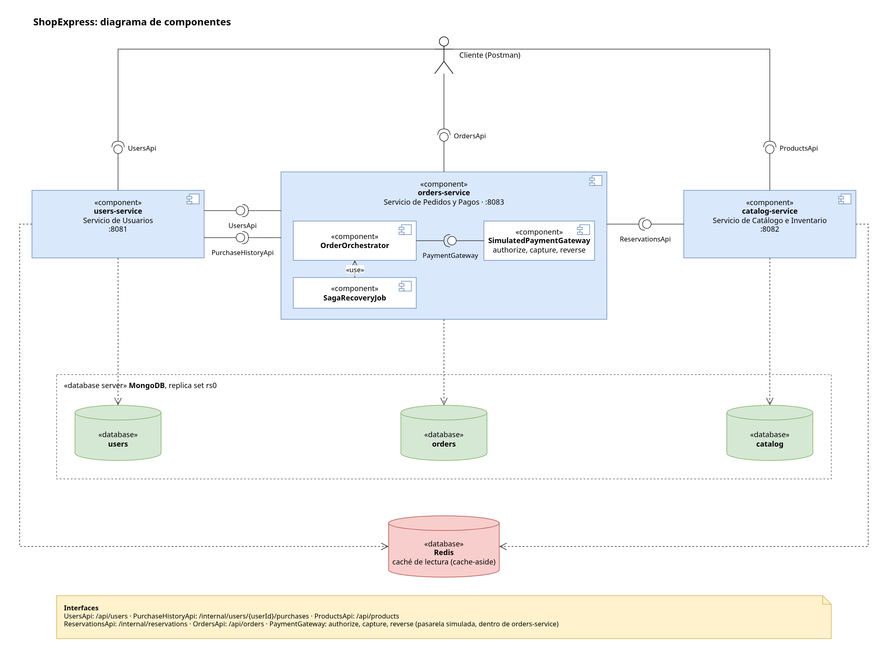
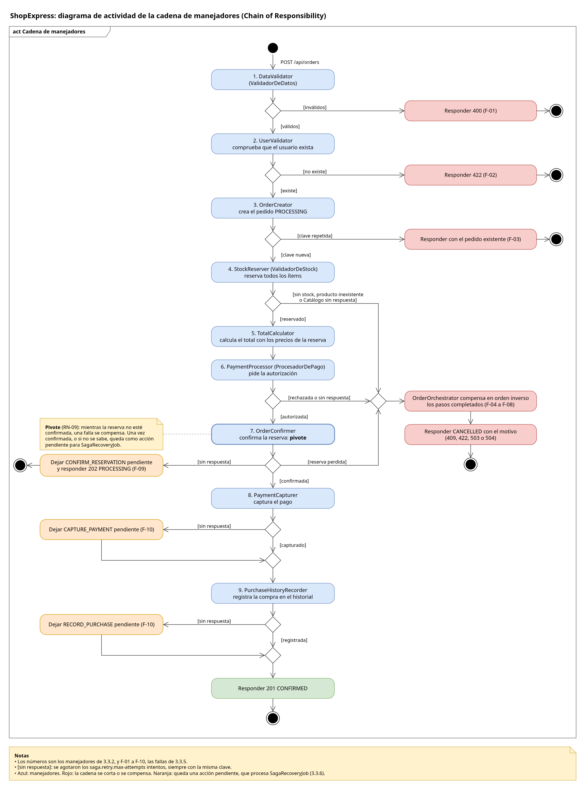
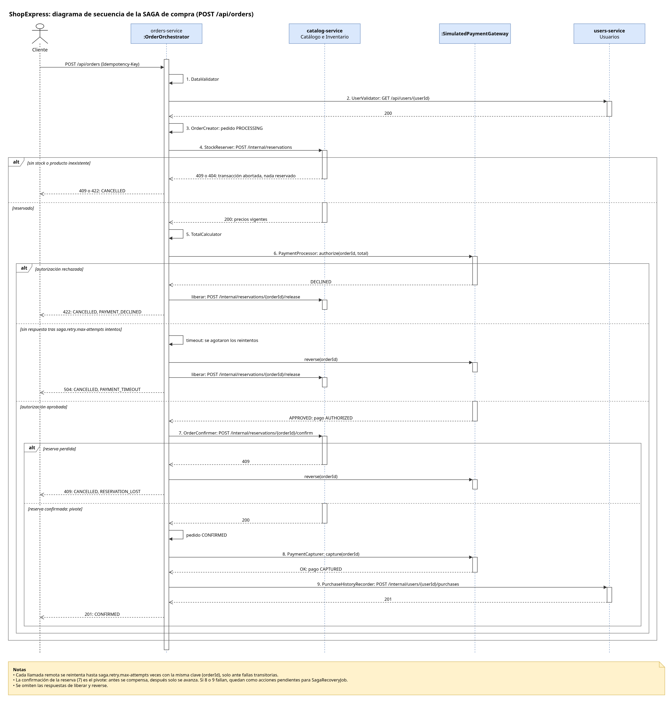

# ShopExpress

Sistema de microservicios para el proceso de compra de una tienda en línea: Tarea 2 de NoSQL 2026.

Hay tres servicios: **Usuarios**, **Catálogo e Inventario** y **Pedidos y Pagos**. El cliente crea usuarios y productos, y compra. La compra reserva el stock, autoriza el pago, confirma la reserva y cobra, y si algo falla en el camino, deshace lo hecho. Las lecturas de usuarios y productos pasan por una caché, y las escrituras que no pueden fallar (el stock y los pedidos) son consistentes: nunca se vende sin stock y nunca se cobra dos veces.

Este README resume el diseño y explica cómo levantar y probar el sistema. El detalle de cada requisito, regla y decisión está en la [especificación de requerimientos](docs/Especificacion_Requerimientos_ShopExpress.md), que es la referencia de este proyecto.

## Arquitectura



| Servicio | Puerto | Qué hace | Base |
| --- | --- | --- | --- |
| `users-service` | 8081 | Usuarios con sus direcciones, e historial de compras | MongoDB `users`, y Redis como caché |
| `catalog-service` | 8082 | Productos, stock y reservas de stock | MongoDB `catalog`, y Redis como caché |
| `orders-service` | 8083 | La compra: la cadena de pasos, la SAGA, la pasarela de pago simulada y el recuperador | MongoDB `orders` |

- **El cliente** solo habla con las rutas `/api/...` de cada servicio.
- **Pedidos llama a los otros dos** por REST síncrono, a rutas `/internal/...` que solo usa él: a Usuarios para validar al comprador y registrar la compra, y a Catálogo para reservar, confirmar y liberar stock.
- **Cada servicio es dueño de su base:** ninguno lee la base de otro. Un servicio que necesita un dato de otro se lo pide por su API.

## Justificación del diseño

Cada punto resume una decisión, con el porqué. Entre paréntesis va su identificador en la [sección 4 de la especificación](docs/Especificacion_Requerimientos_ShopExpress.md#4-decisiones-de-diseño), donde está la alternativa que se descartó y por qué.

### Dos bases NoSQL, cada una para lo que la consigna pide

La consigna pide dos cosas opuestas: lecturas de catálogo y usuarios muy rápidas, que aceptan datos un poco atrasados, y escrituras de pedidos y pagos consistentes, sin sobreventa (D-01).

- **MongoDB es la fuente de verdad de los tres servicios.** Tiene transacciones y updates condicionales atómicos, que es lo que hace falta para descontar stock sin sobreventa. Corre como replica set de un nodo, porque las transacciones lo exigen, con una base por servicio (D-02).
- **Redis es la caché de lectura** de Usuarios y Catálogo. No guarda nada en disco: todo lo que tiene se puede reconstruir desde MongoDB (D-05).
- **Redis no guarda el stock.** Con su configuración por defecto puede perder hasta un segundo de escrituras, y perder un descuento de stock es una sobreventa.

### Modelado: embebido o referencia

| Relación | Modelo | Por qué |
| --- | --- | --- |
| Usuario y direcciones | Embebido, máximo 10 | Son pocas y se leen siempre con el usuario |
| Usuario e historial de compras | Referencia: colección aparte | Crece sin límite, la escribe otro servicio, y embebida, cada compra invalidaría la caché del usuario |
| Producto y stock | Mismo documento | Así el descuento condicional es atómico sobre un solo documento |
| Pedido e ítems | Embebido, con copia del nombre y el precio | El pedido conserva lo que se compró aunque el catálogo cambie después |
| Pedido y pago | Embebido, con el historial de cada operación | Es uno a uno, se lee junto, y el historial solo tiene sentido dentro del pedido |

El detalle de cada colección, con ejemplos e índices, está en la [sección 3.6](docs/Especificacion_Requerimientos_ShopExpress.md#36-modelo-de-datos).

### Consistencia: sin sobreventa y sin pedidos duplicados

- **El stock se descuenta con un update condicional:** "restar 2 solo si el stock es 2 o más", en una sola operación de MongoDB. Leer, comparar y después escribir dejaría una ventana en la que dos compras ven el mismo stock y lo descuentan las dos.
- **Todos los ítems de un pedido se reservan en una transacción** (D-04). Si un ítem no alcanza, no queda ninguno descontado. Si dos transacciones chocan sobre el mismo producto, MongoDB aborta una, y se reintenta hasta 3 veces.
- **El stock solo cambia sumando o restando** (`$inc`), nunca fijando un valor, así una reposición y una venta simultáneas no se pisan.
- **Un pedido es único por su clave** (header `Idempotency-Key`), garantizada por un índice único en MongoDB (D-06). Repetir la misma compra devuelve el mismo pedido; si la original todavía está en curso, responde 409; y si la clave llega con otra compra, 422.

### La compra: Chain of Responsibility

La compra pasa por una cadena de 9 manejadores. Cada uno conoce al siguiente y le pasa la solicitud (D-20). Los tres que nombra la consigna son `DataValidator` (ValidadorDeDatos), `StockReserver` (ValidadorDeStock) y `PaymentProcessor` (ProcesadorDePago).



| # | Manejador | Qué hace | Si un paso posterior falla |
| --- | --- | --- | --- |
| 1 | `DataValidator` | Valida los datos y la clave | — |
| 2 | `UserValidator` | Comprueba que el usuario exista | — |
| 3 | `OrderCreator` | Crea el pedido en `PROCESSING` | Se cancela |
| 4 | `StockReserver` | Reserva todos los ítems en Catálogo | Se libera la reserva |
| 5 | `TotalCalculator` | Calcula el total con los precios de la reserva | — |
| 6 | `PaymentProcessor` | Autoriza el pago: retiene el monto sin cobrarlo | Se reversa |
| 7 | `OrderConfirmer` | Confirma la reserva: **el pivote** | — |
| 8 | `PaymentCapturer` | Cobra lo autorizado | Se reintenta |
| 9 | `PurchaseHistoryRecorder` | Registra la compra en el historial de Usuarios | Se reintenta |

**Se valida reservando y no consultando el stock:** la consulta puede venir de la caché y estar atrasada.

### La compra: SAGA orquestada

`OrderOrchestrator` hace correr la cadena y guarda el avance después de cada paso. Si un paso falla, decide qué hacer (D-12):

- **Antes del pivote,** compensa en orden inverso los pasos que terminaron: reversa el pago, libera la reserva y cancela el pedido con el motivo.
- **Desde el pivote,** no compensa nada. Confirmada la reserva, el stock está vendido: lo que falta (cobrar y registrar en el historial) solo se reintenta, nunca se deshace.



**El orden importa.** Se reserva antes de pagar, así la falta de stock, que es la falla más común, se resuelve sin tocar la pasarela. Y se autoriza antes de cobrar, como las pasarelas reales: si la compra falla, se libera una retención en lugar de devolver un cobro (D-07).

| Caso | Respuesta | Qué se compensó |
| --- | --- | --- |
| Compra aprobada | 201 `CONFIRMED` | Nada |
| Sin stock | 409 `CANCELLED`, `OUT_OF_STOCK` | Nada: la reserva no se hizo y la pasarela no se tocó |
| Pago rechazado | 422 `CANCELLED`, `PAYMENT_DECLINED` | Se liberó la reserva |
| El pago no responde | 504 `CANCELLED`, `PAYMENT_TIMEOUT` | Se reversó la autorización, por si quedó retenida, y se liberó la reserva |
| La reserva se perdió antes de confirmar | 409 `CANCELLED`, `RESERVATION_LOST` | Se reversó la autorización |

La pasarela de pago es simulada. El header `X-Simulated-Payment` (`APPROVED`, `DECLINED` o `NO_RESPONSE`) decide su respuesta, para poder mostrar cada caso. Todo lo que pasa después de esa respuesta es real.

Todos los casos, con sus códigos, están en la [sección 3.3 de la especificación](docs/Especificacion_Requerimientos_ShopExpress.md#33-proceso-de-compra-saga-y-chain-of-responsibility).

### Fallas, reintentos y recuperación

- **Todas las llamadas usan una clave**, el orderId o la clave del pedido. Repetirlas no duplica efectos: Catálogo devuelve la misma reserva y la pasarela, la misma autorización.
- **Dentro de la compra, una falla transitoria se reintenta** (timeout, conexión rechazada o error 5xx): hasta 3 intentos, con esperas de 200 y 400 ms. Un rechazo definitivo, como sin stock o pago rechazado, no se reintenta (D-17).
- **En segundo plano, `SagaRecoveryJob`** corre cada 10 s (D-10). Resuelve lo que la compra no pudo terminar: una reserva que no se pudo liberar, un cobro que falló, o una compra que quedó a medias porque se cayó Pedidos. Si una acción falla 10 veces, el pedido queda marcado con `requiresAttention` para que alguien lo mire.
- **El recuperador no toma compras que siguen en curso.** Cada pedido tiene un lease: hasta cuándo la solicitud que lo procesa puede seguir trabajando. Solo toma pedidos con el lease vencido (D-23).

### Caché

Cache-aside con TTL: 60 s para usuarios y 10 s para productos. Una modificación administrativa (precio, direcciones, reposición) borra la entrada, así la próxima lectura trae el dato nuevo. **Las ventas no la borran**: vaciarían la caché justo en los productos más consultados, y la reserva igual controla contra MongoDB (D-05). Si Redis cae, las lecturas siguen desde MongoDB.

Medido el 29/10/2026, con 10 lecturas simultáneas sobre un mismo producto: **0,71 ms** por lectura con caché y **1,60 ms** sin ella. El detalle está en [Medir la caché](#medir-la-caché).

### Rutas y otros criterios

- **El código y la API están en inglés**, y los textos para personas, en español (D-15). Esta es la equivalencia con las rutas de la consigna:

  | Consigna | ShopExpress |
  | --- | --- |
  | `POST /api/usuarios` | `POST /api/users` |
  | `GET /api/usuarios/{usuario_id}` | `GET /api/users/{userId}` |
  | `GET /api/usuarios/exportar` *(opcional)* | No implementado |
  | `POST /api/productos` | `POST /api/products` |
  | `GET /api/productos/{producto_id}` | `GET /api/products/{productId}` |
  | `POST /api/pedidos` | `POST /api/orders` |

  Además: `GET /api/orders/{orderId}`, `GET /api/users/{userId}/purchases` (historial), `POST /api/users/{userId}/addresses`, `PATCH /api/products/{productId}` y `POST /api/products/{productId}/restock`. La lista completa está en la [sección 3.1](docs/Especificacion_Requerimientos_ShopExpress.md#311-api-pública).
- **Sin borrados** (D-13): los pedidos y el historial apuntan a usuarios y productos.
- **Los ids los genera el servidor**, con un prefijo y un UUID (`usr_…`, `prod_…`, `ord_…`). Cada producto tiene además un **SKU** fijo y único, que es el código para las personas (D-19).
- **Los importes** se guardan como `Decimal128` y no como `double`, que no representa exactamente valores como 0,10 (D-11).

### Patrones avanzados (opcional en la consigna)

- **CQRS, aplicado.** El historial de compras es un modelo de lectura separado de donde se escribe la compra: la compra se escribe en Pedidos, y en el último paso se copia a Usuarios, donde se consulta (D-09). La copia es eventualmente consistente: si Usuarios no responde, la compra aparece cuando vuelve, porque la registra el recuperador.
- **Event Sourcing, no aplicado.** Se aplicaría al pago: en lugar de guardar su estado actual, se guardaría cada operación con la pasarela como un evento (autorizar, capturar, reversar), y el estado se calcularía leyéndolos en orden. El historial del pago (`payment.history`) ya registra esos eventos, pero como complemento del estado y no como su fuente.
- **Seudonimización, diseñada y no implementada.** La exportación de usuarios (RF-08, opcional) sacaría el documento y el email reemplazados por un HMAC con clave secreta. Un hash simple no alcanza: un documento de 8 dígitos tiene 10⁸ valores posibles, y se revierte probándolos todos.

## Levantar y probar

### Requisitos

- **Docker con Docker Compose.** No hace falta Java ni Maven: cada servicio se compila dentro de Docker.
- **JDK 25**, solo para desarrollar o correr los tests fuera de Docker.
- **Node.js**, solo para correr la colección de Postman desde la terminal con Newman.
- **ab (Apache Bench)**, solo para la prueba de carga de la caché.

### Levantar el sistema

```bash
docker compose up --build
```

El primer arranque tarda unos minutos, porque baja las imágenes y las dependencias de Maven.

| Componente | Puerto | Para comprobar que está vivo |
| --- | --- | --- |
| `users-service` | 8081 | `curl http://localhost:8081/actuator/health` |
| `catalog-service` | 8082 | `curl http://localhost:8082/actuator/health` |
| `orders-service` | 8083 | `curl http://localhost:8083/actuator/health` |
| MongoDB 8.0, replica set `rs0` de un nodo | 27017 | `docker compose exec mongodb mongosh --quiet --eval "rs.status().ok"` |
| Redis 8.10, sin persistencia | 6379 | `docker compose exec redis redis-cli ping` |

Cada servicio responde `"status":"UP"` solo si llega a sus bases.

### Probar con Postman

En Postman se importan los dos archivos de `postman/` y se elige el entorno **ShopExpress local**. La colección tiene dos carpetas:

- **Demo:** 8 pedidos que cuentan una compra de punta a punta. Se mandan de a uno, en orden, y cada uno explica en su descripción qué muestra.

  | # | Pedido | Qué muestra |
  | --- | --- | --- |
  | 1 y 2 | Preparar | Una compradora y un producto con 2 unidades |
  | 3 | Compra aprobada | 201 `CONFIRMED`, con el pago autorizado y después cobrado |
  | 4 | Repetir la misma compra | El mismo pedido: no compra dos veces |
  | 5 | Compra sin stock | 409, sin tocar la pasarela |
  | 6 | Compra con pago rechazado | 422, y la reserva se libera |
  | 7 | Consultar el producto | Queda 1 unidad: solo la compra aprobada se llevó stock |
  | 8 | Historial de compras | Solo la compra aprobada |

- **Pruebas:** todas las verificaciones, carpeta por carpeta (Usuarios, Catálogo, Reservas y Pedidos). Se corren enteras con **Run**, y tienen que salir en verde.

Desde la terminal, la colección entera se corre con Newman:

```bash
npx newman run postman/ShopExpress.postman_collection.json -e postman/ShopExpress.postman_environment.json
```

La colección crea datos nuevos en cada corrida, así que se puede correr varias veces seguidas.

### Pruebas de concurrencia

Postman manda un pedido por vez, y estos problemas solo aparecen con muchos a la vez. Los dos scripts terminan en `OK` o en `NO COINCIDE`:

```bash
scripts/concurrencia-stock.sh       # 200 reservas y 100 reposiciones a la vez sobre un producto
scripts/idempotencia-pedidos.sh     # la misma compra, con la misma clave, 10 veces a la vez
```

- **`concurrencia-stock.sh`** comprueba que el stock final sea exactamente el inicial, más lo repuesto, menos lo reservado, y que nunca quede negativo. Por ejemplo: `Stock final: 0. Esperado: 50 + 100 - 150 = 0`.
- **`idempotencia-pedidos.sh`** comprueba que quede un solo pedido, una sola reserva y un solo cobro: una solicitud crea el pedido y las otras reciben 409 o el mismo pedido.

### Probar las fallas

Las fallas se provocan deteniendo un servicio. Para que dé tiempo a detenerlo a mitad de una compra, `SAGA_STEP_DELAY_MS` agrega una demora entre pasos:

```bash
SAGA_STEP_DELAY_MS=3000 docker compose up -d orders-service   # cada paso de la compra espera 3 s
docker compose up -d orders-service                           # vuelve a la normalidad
```

| Qué probar | Cómo | Qué tiene que pasar |
| --- | --- | --- |
| Catálogo caído | `docker compose stop catalog-service` y comprar | 503 `CATALOG_UNAVAILABLE`, sin stock reservado cuando vuelve |
| Usuarios caído durante una compra | Con la demora, detener Usuarios a mitad | La compra termina `CONFIRMED`; el historial la muestra cuando Usuarios vuelve |
| Pedidos se cae a mitad | Con la demora, `docker compose kill orders-service` y después `start` | El recuperador cancela la compra con `INTERRUPTED` y devuelve el stock, o la completa si ya había pasado el pivote |

Cada servicio deja en el log, en español, cada reintento y cada acción del recuperador: `docker compose logs -f orders-service`.

### Ver la caché

Usuarios y Catálogo guardan en Redis, en JSON, cada usuario y cada producto que se consulta. Para ver qué hay guardado:

```bash
docker compose exec redis redis-cli --scan --pattern 'products::*'
docker compose exec redis redis-cli GET 'products::<id del producto>'
```

Cuando una consulta no encuentra el dato en Redis y lo lee de MongoDB, el servicio lo registra en el log. Si se consulta dos veces seguidas el mismo producto, la línea aparece una sola vez:

```bash
docker compose logs -f catalog-service | grep "leído de MongoDB"
```

Si se detiene Redis con `docker compose stop redis`, las consultas siguen respondiendo desde MongoDB, y cada operación de la caché que falla queda en el log como aviso.

### Medir la caché

`scripts/carga-lecturas.sh` lee muchas veces el mismo producto y muestra el tiempo medio de cada lectura. Se corre una vez con la caché y otra sin ella:

```bash
scripts/carga-lecturas.sh                                     # con caché
SPRING_CACHE_TYPE=none docker compose up -d catalog-service   # Catálogo sin caché
scripts/carga-lecturas.sh                                     # sin caché
docker compose up -d catalog-service                          # vuelve a la caché
```

Resultado en la máquina de desarrollo, el 29/10/2026, con 10 lecturas simultáneas. Cada valor es la mediana de 3 rondas de 50 000 lecturas, después de 15 s de calentamiento:

| | Tiempo medio por lectura | Lecturas por segundo |
| --- | --- | --- |
| Con caché | 0,71 ms | 14 000 |
| Sin caché | 1,60 ms | 6 200 |

Parte de la diferencia es el log que deja cada lectura en MongoDB: sin ese log, la lectura sin caché baja a 1,33 ms.

### Ver los datos en MongoDB

Con Compass o `mongosh`, usar `mongodb://localhost:27017/?directConnection=true`.

`directConnection=true` es necesario porque el replica set anuncia a su miembro como `mongodb:27017`, un nombre que solo existe dentro de la red de Docker. Sin esa opción, el cliente intentaría conectarse a ese nombre y fallaría.

### Detener

```bash
docker compose down      # conserva los datos de MongoDB
docker compose down -v   # borra también los datos, para empezar de cero
```

### Desarrollar un servicio fuera de Docker

Se levantan solo las bases con Compose y el servicio se corre desde la máquina:

```bash
docker compose up -d mongodb redis
cd users-service
./mvnw spring-boot:run
```

Si el sistema completo ya está levantado, el contenedor del servicio ocupa su puerto y el servicio local no puede arrancar. Antes de correrlo, detené ese contenedor, por ejemplo con `docker compose stop users-service`. Pedidos, además, necesita a los otros dos servicios.

## Limitaciones

Las principales; la lista completa, con su argumento, está en la [sección 5 de la especificación](docs/Especificacion_Requerimientos_ShopExpress.md#5-limitaciones-conocidas).

- **Un nodo por motor:** no hay alta disponibilidad ni tolerancia a particiones real.
- **REST síncrono:** si Catálogo o Usuarios no responden, no se puede comprar. La evolución sería un broker de mensajes (D-03).
- **Un pedido con `requiresAttention` no se resuelve solo:** hace falta intervenir a mano. La acción pendiente dice qué faltó, cuántas veces se intentó y el último error.
- **El pago es simulado y no hay autenticación:** los dos están fuera del alcance de la consigna.

## Estructura del repositorio

```text
ShopExpress/
├── README.md
├── docker-compose.yml
├── docs/
│   ├── Especificacion_Requerimientos_ShopExpress.md   requisitos, decisiones y limitaciones
│   └── diagramas/                                     componentes, SAGA y cadena (.png y .drawio editable)
├── users-service/      Servicio de Usuarios
├── catalog-service/    Servicio de Catálogo e Inventario
├── orders-service/     Servicio de Pedidos y Pagos
├── postman/            colección (Demo y Pruebas) y entorno
└── scripts/            replica set, pruebas de concurrencia y de carga
```
