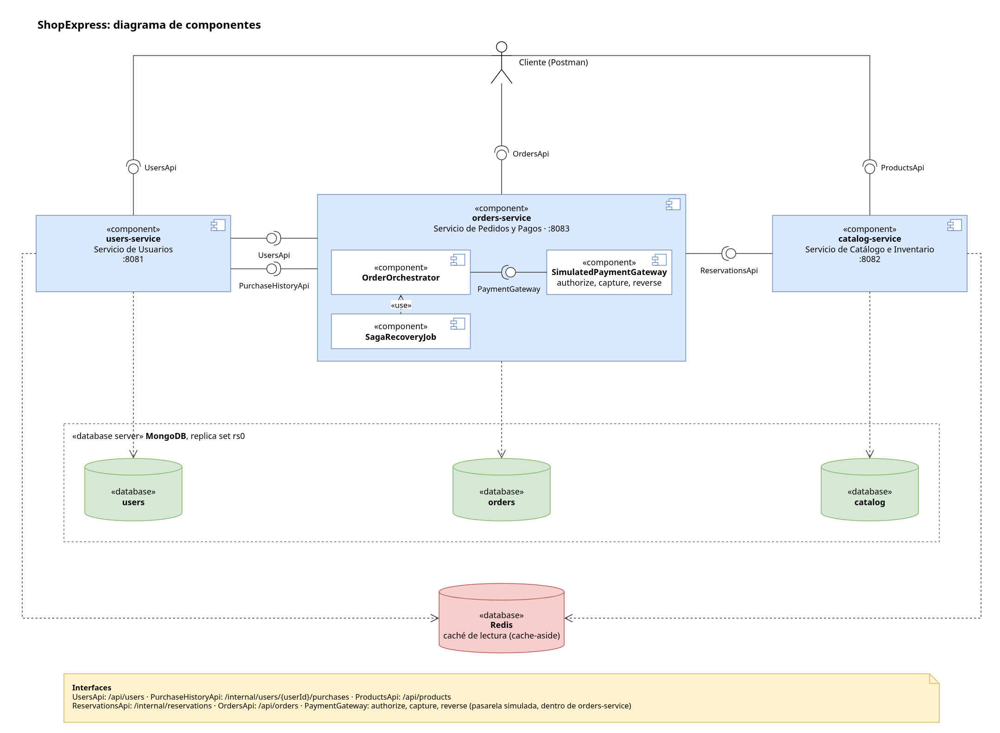
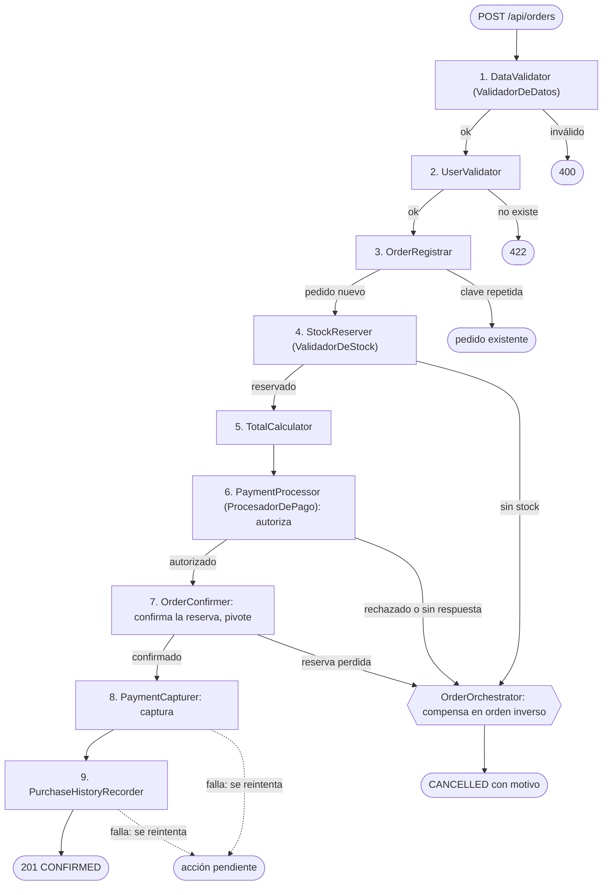
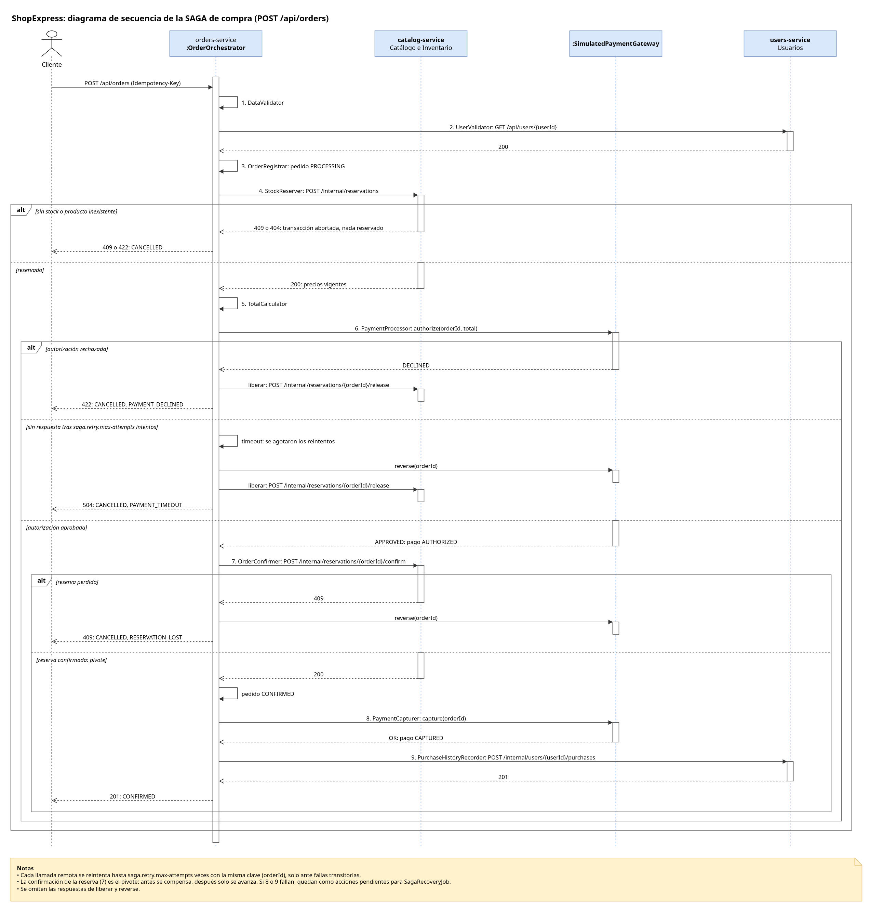
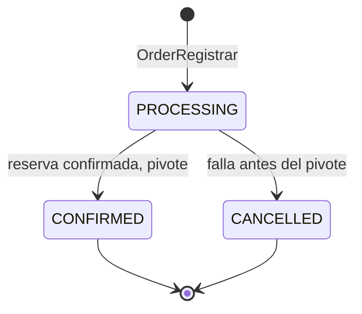
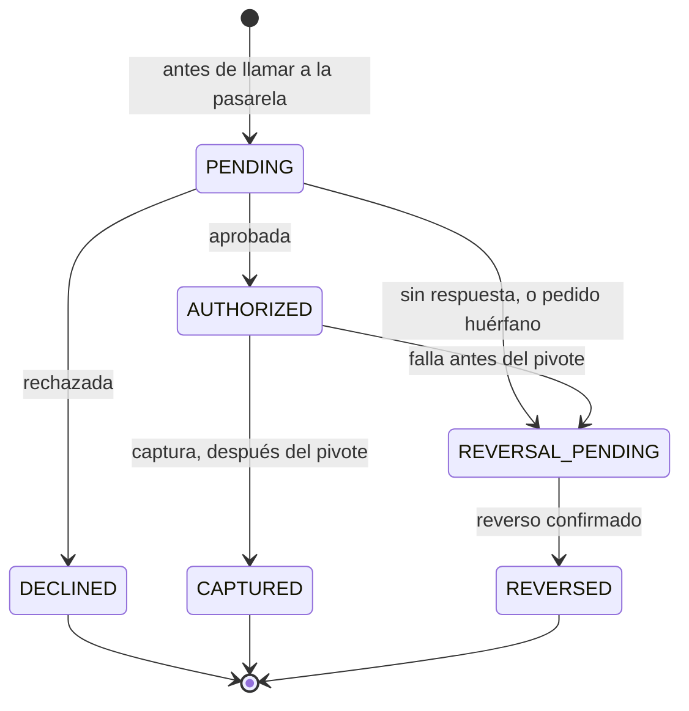

# Especificación de Requerimientos de Software: ShopExpress

| | |
| --- | --- |
| Proyecto | Tarea 2, NoSQL 2026: sistema de microservicios para comercio electrónico |
| Fecha | 28 de octubre de 2026 |
| Versión | 1.3 |
| Estado | En implementación. INC-0 está terminado: el despliegue desde cero (CA-19) se verificó. Los demás requisitos todavía no están implementados. |
| Ubicación | `docs/` del repositorio. Es la única versión vigente de este documento. |

## 1. Introducción

### 1.1. Propósito

Este documento define qué debe hacer ShopExpress, con qué restricciones y cómo se comprueba cada requisito. Es la referencia para implementar, probar y defender la solución. Si cambia un comportamiento, se actualiza primero este documento y después el código.

### 1.2. Alcance

ShopExpress es una plataforma ficticia de venta en línea, formada por tres microservicios:

- **Usuarios:** perfiles, direcciones de envío e historial de compras.
- **Catálogo e Inventario:** productos, categorías, precios y stock.
- **Pedidos y Pagos:** creación de pedidos y pago, coordinados con los otros dos servicios.

El sistema expone una API REST, persiste en MongoDB y usa Redis como caché de lectura. Se despliega con Docker Compose. Lo que queda fuera del alcance está en 2.6.

### 1.3. Definiciones

| Término | Significado en este documento |
| --- | --- |
| Cache-aside | Se lee primero de la caché. Si el dato no está, se lee de la base y se guarda una copia en la caché. |
| TTL | Tiempo de vida de una entrada de la caché. |
| Consistencia eventual | Una lectura puede mostrar un dato atrasado durante un tiempo acotado. |
| SAGA | Transacción distribuida dividida en pasos locales, con compensaciones si un paso falla. |
| Orquestador | Componente que coordina los pasos de la SAGA. Acá es `OrderOrchestrator`. |
| Compensación | Acción que deshace el efecto de un paso ya completado. |
| Pivote | Paso a partir del cual la SAGA ya no compensa: solo avanza. Acá es la confirmación de la reserva. |
| Chain of Responsibility | Secuencia de manejadores que procesan la solicitud uno tras otro. |
| Autorización | La pasarela aprueba o rechaza el pago y retiene el monto, sin cobrarlo todavía. |
| Captura | Hace efectivo el cobro de una autorización aprobada. |
| Reverso | Anula una autorización y libera la retención, sin mover plata. |
| Idempotencia | Propiedad por la cual repetir una operación no cambia el resultado. |
| Clave de idempotencia | Identificador que se envía con la operación para que el receptor reconozca los reintentos. |
| Falla transitoria | No hubo una respuesta definitiva (timeout, conexión rechazada o error 5xx). Reintentar puede resolverla. |
| Falla definitiva | La otra parte respondió que no (un error 4xx o un rechazo). Reintentar no cambia el resultado. |
| Acción pendiente | Algo que quedó por hacer después de decidir el resultado del pedido, como liberar una reserva o capturar un pago. |
| Lease | Plazo durante el cual un pedido está tomado por el proceso que lo atiende. Si vence sin renovarse, el recuperador puede retomarlo. |
| Reserva | Descuento de stock asociado a un pedido, que se confirma o se libera. |
| Lápida | Reserva liberada y vacía. Impide que una reserva que llega tarde se aplique. |
| Replica set | Grupo de nodos de MongoDB. Acá tiene un solo nodo, necesario para usar transacciones. |
| DTO | Objeto que define lo que expone la API, separado del documento que se guarda en la base. |

### 1.4. Referencias

| ID | Fuente |
| --- | --- |
| R-01 | Consigna: Tarea 2 NoSQL 2026, 4 páginas, entregada por el docente en PDF |
| R-02 | [MongoDB: Transactions](https://www.mongodb.com/docs/manual/core/transactions/) |
| R-03 | [MongoDB: Production Considerations (write conflicts)](https://www.mongodb.com/docs/manual/core/transactions-production-consideration/) |
| R-04 | [MongoDB: Atomicity and Transactions](https://www.mongodb.com/docs/manual/core/write-operations-atomicity/) |
| R-05 | [Spring Data MongoDB: Sessions and Transactions](https://docs.spring.io/spring-data/mongodb/reference/mongodb/client-session-transactions.html) |
| R-06 | [Spring Data MongoDB: Mapping](https://docs.spring.io/spring-data/mongodb/reference/mongodb/mapping/mapping.html) |
| R-07 | [Spring Framework: CachingConfigurer](https://docs.spring.io/spring-framework/docs/current/javadoc-api/org/springframework/cache/annotation/CachingConfigurer.html) |
| R-08 | [Redis: Cache-aside](https://redis.io/docs/latest/develop/use-cases/cache-aside/) |
| R-09 | [Redis: Persistence](https://redis.io/docs/latest/operate/oss_and_stack/management/persistence/) |
| R-10 | [Redis: Replication](https://redis.io/docs/latest/operate/oss_and_stack/management/replication/) |
| R-11 | [Redis: Scripting with Lua](https://redis.io/docs/latest/develop/programmability/eval-intro/) |
| R-12 | [Apache Cassandra: CQL DML](https://cassandra.apache.org/doc/latest/cassandra/developing/cql/dml.html) |
| R-13 | [Microsoft Azure: Saga design pattern](https://learn.microsoft.com/en-us/azure/architecture/patterns/saga) |
| R-14 | [IETF: The Idempotency-Key HTTP Header Field, borrador 08](https://datatracker.ietf.org/doc/draft-ietf-httpapi-idempotency-key-header/) |
| R-15 | [microservices.io: Database per service](https://microservices.io/patterns/data/database-per-service.html) |
| R-16 | [Quarkus: MongoDB with Panache](https://quarkus.io/guides/mongodb-panache) |
| R-17 | [Quarkus: Redis Cache](https://quarkus.io/guides/cache-redis-reference) |
| R-18 | [Stripe: Place a hold on a payment method](https://docs.stripe.com/payments/place-a-hold-on-a-payment-method) |
| R-19 | [Adyen: Capture](https://docs.adyen.com/online-payments/capture) |
| R-20 | [Spring PetClinic Microservices: repositorio y `docker-compose.yml`](https://github.com/spring-petclinic/spring-petclinic-microservices) |
| R-21 | [Docker: Networking in Compose](https://docs.docker.com/compose/how-tos/networking/) |
| R-22 | [Microsoft eShop: `AppHost.cs`](https://github.com/dotnet/eShop/blob/main/src/eShop.AppHost/AppHost.cs) |
| R-23 | [microservices.io: Decompose by business capability](https://microservices.io/patterns/decomposition/decompose-by-business-capability.html) |

### 1.5. Convenciones del documento

- **Exigido:** el requisito aparece en la consigna (R-01).
- **Prioridad:**
  - **P1:** exigido, o imprescindible para cumplir algo exigido.
  - **P2:** fortalece la demostración y la defensa.
  - **P3:** se hace si sobra tiempo.
- **Nombres:** los que van en `monoespaciado` son los del código y la API, en inglés (Anexo A).
- **Identificadores:**

| Prefijo | Qué identifica | Sección |
| --- | --- | --- |
| RF | Requisito funcional | 3.2 |
| RNF | Requisito no funcional | 3.5 |
| RN | Regla de negocio | 3.4 |
| RD | Restricción de diseño | 2.4 |
| S | Supuesto | 2.5 |
| P | Pendiente | 2.5 |
| INT | Interfaz interna | 3.1.2 |
| F | Falla de la compra | 3.3.5 |
| CA | Criterio de aceptación | 3.7 |
| D | Decisión de diseño | 4 |
| INC | Incremento del plan | Anexo B |
| ENT | Entregable | Anexo C |

## 2. Descripción general

### 2.1. Perspectiva del producto

Cada servicio es un proyecto Spring Boot independiente, con su propia base de datos dentro de una instancia de MongoDB:

- El cliente usa la API pública de cada servicio.
- Pedidos y Pagos coordina la compra: llama a los endpoints internos de los otros dos servicios y a una pasarela de pago simulada.
- Usuarios y Catálogo sirven sus lecturas a través de Redis.



Diagrama de componentes UML. La bola marca la interfaz que provee cada servicio, y el zócalo, quién la usa. Fuente editable: `diagramas/componentes.drawio`.

### 2.2. Funciones del producto

- **Usuarios:**
  - alta y consulta de usuarios;
  - alta de direcciones;
  - consulta del historial de compras;
  - exportación anonimizada (opcional).
- **Catálogo e Inventario:**
  - alta, consulta y modificación de productos;
  - reposición de stock;
  - reserva, liberación y confirmación de stock para los pedidos.
- **Pedidos y Pagos:**
  - creación de pedidos, mediante una cadena de manejadores orquestada como SAGA;
  - autorización, captura y reverso del pago con una pasarela simulada;
  - consulta del pedido y del historial de su pago.

### 2.3. Usuarios del sistema

| Actor | Qué hace | Cómo accede |
| --- | --- | --- |
| Cliente | Se registra, consulta productos, compra y consulta sus pedidos e historial. | API REST; en la demo, con Postman. |
| Administrador | Crea y modifica productos, y repone stock. | API REST, sin autenticación. |
| Evaluador | Levanta el sistema y ejecuta las pruebas. | README, Docker Compose y colección Postman. |

### 2.4. Restricciones

| ID | Restricción | Origen |
| --- | --- | --- |
| RD-01 | Tres microservicios en directorios separados de un mismo repositorio. | Exigido. |
| RD-02 | Al menos dos bases NoSQL asignadas a los servicios. Se usan MongoDB y Redis (D-01). | Exigido. Redis puede cumplir cualquier rol (confirmado con el docente). |
| RD-03 | SAGA orquestada, con Pedidos y Pagos como orquestador central. | Exigido. |
| RD-04 | Chain of Responsibility para la lógica de Pedidos y Pagos. | Exigido. |
| RD-05 | Un lenguaje y framework de la lista de la consigna. Se usa Java con Spring Boot (D-14). | Exigido. |
| RD-06 | `docker-compose.yml` y un `Dockerfile` por servicio. | Valorado por la consigna; se adopta. |
| RD-07 | Código y contrato HTTP en inglés; textos para personas en español (Anexo A). | Decisión del estudiante (D-15). |
| RD-08 | Entorno de desarrollo: Java 24.0.2, Maven 3.9.16, Docker 29.7.2 y Docker Compose 5.5.1, comprobados el 24/10/2026. | Entorno del estudiante. |

### 2.5. Supuestos, acuerdos y pendientes

**Supuestos**

| ID | Supuesto | Motivo |
| --- | --- | --- |
| S-01 | La lista de endpoints de la consigna es el contrato mínimo; "gestionar" describe la responsabilidad de cada servicio. | La consigna detalla solo altas y consultas. |
| S-02 | SAGA y Chain of Responsibility son obligatorios. | La consigna los "sugiere", pero después los exige en el endpoint de pedidos y en los diagramas. |
| S-03 | "Servicio de Reservas y Pagos" (pág. 3) es una errata por "Pedidos y Pagos". | El resto de la consigna usa "Pedidos y Pagos". |
| S-04 | "Pedido único" significa que un reintento no crea otra compra. | Un identificador único no alcanza si el cliente reintenta después de perder la respuesta. |
| S-05 | El pago se simula. | La consigna no pide una pasarela real. |

**Acuerdos confirmados:**

- El trabajo es individual.
- Redis puede usarse con cualquier rol, siempre que se usen dos motores NoSQL.
- La demo de la defensa se hace con Postman, sin interfaz gráfica (confirmado por el tutor el 29/10/2026).

**Pendientes**

| ID | Pregunta | Impacto | Prioridad |
| --- | --- | --- | --- |
| P-01 | ¿La entrega es el 5/11 y la defensa el 12/11, o hay que defender el 5? | Si la entrega es el 12, hay una semana más para P3. Mientras tanto, se planifica para el 5. | Alta |
| P-02 | ¿El docente acepta los diagramas que siguen en Mermaid (Chain of Responsibility y estados), o los quiere como imagen? | Si no los acepta, se pasan a draw.io como los de arquitectura y SAGA. | Baja |

### 2.6. Fuera de alcance

- Autenticación y autorización de usuarios.
- Interfaz web: el tutor confirmó que la demo se hace con Postman.
- Pasarela de pago real.
- Devoluciones de pagos ya capturados.
- Resolución de pedidos con `requiresAttention`: se hace a mano.
- Borrado de usuarios y productos, y listados o búsquedas por categoría (D-13).
- Más de una moneda.
- Vencimiento automático de reservas.

## 3. Requisitos específicos

### 3.1. Interfaces externas

#### 3.1.1. API pública

| RF | Método y ruta | Ruta en la consigna | Servicio |
| --- | --- | --- | --- |
| RF-01 | `POST /api/users` | `POST /api/usuarios` | Usuarios |
| RF-02 | `GET /api/users/{userId}` | `GET /api/usuarios/{usuario_id}` | Usuarios |
| RF-03 | `POST /api/products` | `POST /api/productos` | Catálogo |
| RF-04 | `GET /api/products/{productId}` | `GET /api/productos/{producto_id}` | Catálogo |
| RF-05 | `POST /api/orders` | `POST /api/pedidos` | Pedidos |
| RF-06 | `GET /api/orders/{orderId}` | — | Pedidos |
| RF-07 | `GET /api/users/{userId}/purchases` | — | Usuarios |
| RF-08 | `GET /api/users/export` | `GET /api/usuarios/exportar` | Usuarios |
| RF-09 | `PATCH /api/products/{productId}` | — | Catálogo |
| RF-10 | `POST /api/products/{productId}/restock` | — | Catálogo |
| RF-11 | `POST /api/users/{userId}/addresses` | — | Usuarios |

**Convenciones comunes**

- **JSON:** campos en camelCase. Cada recurso expone su identificador como `id`; las referencias a otros recursos usan `<entity>Id`, como `userId` o `productId`.
- **Identificadores:** los genera el servidor, con un prefijo y un UUID: `usr_…`, `prod_…`, `ord_…`.
- **Importes:** números con dos decimales, en UYU.
- **Fechas:** ISO-8601, en UTC.
- **Errores:** `{ "code": "OUT_OF_STOCK", "message": "No hay stock suficiente del producto prod_7d10…" }`. El `code` va en inglés y no cambia; el `message` va en español.
- **Headers de RF-05:**
  - `Idempotency-Key` es obligatorio.
  - `X-Simulated-Payment` es opcional y fuerza el resultado de la pasarela:
    - `APPROVED` (por defecto): la autorización se aprueba.
    - `DECLINED`: la autorización se rechaza.
    - `NO_RESPONSE`: la pasarela autoriza, pero nunca responde a tiempo. Simula una respuesta perdida.

#### 3.1.2. Interfaces internas

Solo las usan los servicios entre sí, por REST síncrono. Todas son idempotentes por `orderId`: repetir una llamada con la misma clave no duplica efectos.

| ID | Servicio | Ruta | Uso | Comportamiento ante repeticiones |
| --- | --- | --- | --- | --- |
| INT-01 | Catálogo | `POST /internal/reservations` | Reserva `{orderId, items}` en una sola transacción y devuelve los nombres y precios vigentes. | Repetir devuelve la misma reserva. Si la reserva ya estaba `RELEASED`, responde 409. |
| INT-02 | Catálogo | `POST /internal/reservations/{orderId}/release` | Libera la reserva (compensación). | Solo el paso de `RESERVED` a `RELEASED` repone stock. Si la reserva no existe, crea una lápida. |
| INT-03 | Catálogo | `POST /internal/reservations/{orderId}/confirm` | Confirma la reserva. Es el pivote de la compra. | Pasa de `RESERVED` a `CONFIRMED`; repetirla no tiene efecto. Si la reserva está `RELEASED`, responde 409. |
| INT-04 | Usuarios | `POST /internal/users/{userId}/purchases` | Registra la compra en el historial. | La entrada usa `orderId` como `_id`. |

`SimulatedPaymentGateway` vive dentro de Pedidos y Pagos y ofrece `authorize`, `capture` y `reverse`, también idempotentes por `orderId`. Para validar el usuario, Pedidos llama a RF-02 y solo mira el código de estado (200 o 404).

### 3.2. Requisitos funcionales

#### Servicio de Usuarios

**RF-01. Crear usuario.** `POST /api/users`. Exigido, P1. CA-01, CA-13.
- **Obligatorios:** `documentType`, `documentNumber`, `firstName`, `lastName` y `email`.
- **Opcional:** `addresses`. Cada dirección exige `street`, `city` y `postalCode`, con un máximo de 10 (RN-11).
- **Únicos:** `email` y el par `documentType` + `documentNumber`.
- **Respuestas:**
  - 201 con el usuario y su `id`;
  - 400 si falla una validación;
  - 409 si el email o el documento ya existen.

**RF-02. Consultar usuario.** `GET /api/users/{userId}`. Exigido, P1. CA-01, CA-14.
- Puede responder desde la caché (RNF-01).
- **Respuestas:** 200; 404.

**RF-07. Consultar historial de compras.** `GET /api/users/{userId}/purchases`. P2. CA-12.
- Devuelve las compras confirmadas, de la más reciente a la más antigua. Cada una trae `orderId`, `date`, `total` e `items`.
- Es eventualmente consistente: una compra recién confirmada puede tardar en aparecer.
- **Respuestas:** 200 con la lista, que puede estar vacía; 404 si el usuario no existe.

**RF-08. Exportar usuarios anonimizados.** `GET /api/users/export?format=json` (o `csv`). Opcional en la consigna, P3.
- El documento y el email salen seudonimizados con un HMAC con clave secreta. No alcanza con un hash simple: un documento de 8 dígitos tiene 10⁸ valores posibles y se revierte probándolos todos.
- No se exportan las direcciones completas.
- **Respuesta:** 200.

**RF-11. Agregar dirección.** `POST /api/users/{userId}/addresses`. P2. CA-18.
- **Entrada:** `street`, `city` y `postalCode`, todos obligatorios.
- Invalida la caché del usuario.
- **Respuestas:**
  - 201 con el usuario y sus direcciones;
  - 400 si falla una validación;
  - 404 si el usuario no existe;
  - 422 si el usuario ya tiene 10 direcciones (RN-11).

#### Servicio de Catálogo e Inventario

**RF-03. Crear producto.** `POST /api/products`. Exigido, P1. CA-02.
- **Obligatorios:** `name`, `price` (mayor que 0) y `stock` (entero, 0 o más).
- **Opcionales:** `description` y `categories` (lista de nombres).
- **Respuestas:** 201 con el producto y su `id`; 400.

**RF-04. Consultar producto y stock.** `GET /api/products/{productId}`. Exigido, P1. CA-02, CA-10, CA-11.
- Puede responder desde la caché. El stock que muestra puede estar atrasado hasta un TTL (RNF-01).
- **Respuestas:** 200; 404.

**RF-09. Modificar producto.** `PATCH /api/products/{productId}`. P2. CA-16.
- Acepta `name`, `description`, `categories` y `price`, con las mismas reglas que el alta.
- Rechaza `stock` e `id` (RN-12).
- Invalida la caché del producto.
- **Respuestas:** 200 con el producto actualizado; 400; 404.

**RF-10. Reponer stock.** `POST /api/products/{productId}/restock`. P2. CA-17.
- **Entrada:** `quantity`, un entero mayor que 0.
- Suma al stock actual con un incremento atómico (RN-12) e invalida la caché.
- **Respuestas:** 200 con el producto y su nuevo stock; 400; 404.

#### Servicio de Pedidos y Pagos

**RF-05. Crear pedido.** `POST /api/orders`. Exigido, P1. CA-03 a CA-08, CA-10, CA-13, CA-15 y CA-20.

Recorre la cadena de manejadores orquestada como SAGA (sección 3.3). El cliente no envía precios ni total (RN-05).

```http
POST /api/orders
Idempotency-Key: 6f1c2a9e-5b8d-4c0e-9a51-2f7e3c1d8b44
X-Simulated-Payment: APPROVED
Content-Type: application/json

{
  "userId": "usr_3f2a…",
  "items": [ { "productId": "prod_7d10…", "quantity": 2 } ],
  "payment": { "method": "CREDIT_CARD" }
}
```

La respuesta es síncrona y trae el estado final del pedido, con el historial de su pago:

```json
{
  "id": "ord_98c1…",
  "userId": "usr_3f2a…",
  "status": "CONFIRMED",
  "reason": null,
  "items": [ { "productId": "prod_7d10…", "name": "Mate de calabaza", "quantity": 2, "unitPrice": 25.50 } ],
  "total": 51.00,
  "currency": "UYU",
  "payment": {
    "method": "CREDIT_CARD",
    "status": "CAPTURED",
    "authorizationCode": "auth_45a7…",
    "history": [
      { "operation": "AUTHORIZE", "result": "APPROVED", "attempt": 1, "at": "2026-11-02T14:03:10Z" },
      { "operation": "CAPTURE", "result": "OK", "attempt": 1, "at": "2026-11-02T14:03:11Z" }
    ]
  },
  "createdAt": "2026-11-02T14:03:10Z"
}
```

| Resultado | HTTP | Pedido | Pago |
| --- | --- | --- | --- |
| Confirmado | 201 | `CONFIRMED` | `CAPTURED` (o `AUTHORIZED` mientras la captura se reintenta) |
| Datos inválidos | 400 | No se crea | — |
| Usuario inexistente | 422 | No se crea | — |
| Producto inexistente | 422 | `CANCELLED`, `PRODUCT_NOT_FOUND` | Sin autorización |
| Sin stock | 409 | `CANCELLED`, `OUT_OF_STOCK` | Sin autorización |
| Catálogo no responde al reservar | 503 | `CANCELLED`, `CATALOG_UNAVAILABLE` | Sin autorización |
| Autorización rechazada | 422 | `CANCELLED`, `PAYMENT_DECLINED` | `DECLINED` |
| Autorización sin respuesta | 504 | `CANCELLED`, `PAYMENT_TIMEOUT` | `REVERSED` (o `REVERSAL_PENDING` mientras el reverso se reintenta) |
| Reserva perdida antes de confirmarse | 409 | `CANCELLED`, `RESERVATION_LOST` | `REVERSED` (o `REVERSAL_PENDING`) |
| Catálogo no responde al confirmar la reserva | 202 | `PROCESSING`; se consulta con RF-06 | `AUTHORIZED` |
| Repetición de una solicitud ya terminada | El mismo código y cuerpo que la original | Sin cambios | Sin cambios |
| Misma clave, con la solicitud original todavía en curso | 409 | Sin cambios | Sin cambios |
| Misma clave con otro cuerpo | 422 | Sin cambios | Sin cambios |

**RF-06. Consultar pedido.** `GET /api/orders/{orderId}`. P2. CA-08, CA-16, CA-20.
- Devuelve el pedido con la misma forma que RF-05, incluido el historial completo del pago.
- **Respuestas:** 200; 404.

### 3.3. Proceso de compra: SAGA y Chain of Responsibility

#### 3.3.1. Cómo se combinan

Los manejadores de la cadena son los pasos de la SAGA (D-12):

- **La cadena** define qué pasos se ejecutan y en qué orden.
- **El orquestador** decide qué hacer cuando uno falla.

Las piezas:

- **Cada manejador** implementa `OrderHandler.handle(OrderContext)`: hace su parte y decide si la solicitud sigue al siguiente manejador o se corta. Los manejadores con efectos también implementan `compensate(OrderContext)`.
- **`OrderOrchestrator`** hace correr la cadena y guarda el avance después de cada paso. No implementa ningún paso.
  - **Si un paso falla antes del pivote:** el pedido pasa a `CANCELLED` y los pasos completados se compensan en orden inverso.
  - **A partir del pivote:** no se compensa nada. Los pasos que falten se completan, reintentándolos.

**El orden importa.** Primero se reserva el stock y después se autoriza el pago:

- La falla más común, la falta de stock, se resuelve sin tocar la pasarela.
- El monto que se autoriza sale de los precios de la reserva.

El pivote es la confirmación de la reserva: una vez confirmada, ya no se puede liberar (RN-09).

#### 3.3.2. Manejadores

La consigna nombra tres manejadores en español. La columna "Clase" indica su equivalente en el código.

| # | Clase | Responsabilidad | Si un paso posterior falla antes del pivote | Tipo de paso |
| --- | --- | --- | --- | --- |
| 1 | `DataValidator` (ValidadorDeDatos en la consigna) | Comprueba que haya clave, que haya al menos un ítem, que las cantidades sean enteras y positivas y que no se repitan productos. No tiene efectos. | — | Validación |
| 2 | `UserValidator` | Comprueba que el usuario exista (RF-02). No tiene efectos. | — | Validación |
| 3 | `OrderRegistrar` | Crea el pedido en `PROCESSING`. Si la clave ya existe, corta la cadena y devuelve el pedido existente. | El pedido pasa a `CANCELLED`. | Compensable |
| 4 | `StockReserver` (ValidadorDeStock en la consigna) | Reserva todos los ítems (INT-01) y recibe los precios vigentes. Valida reservando, porque una lectura podría venir de la caché (RN-08). | Se libera la reserva (INT-02). | Compensable |
| 5 | `TotalCalculator` | Calcula el total con los precios de la reserva. | — | — |
| 6 | `PaymentProcessor` (ProcesadorDePago en la consigna) | Pide la autorización a la pasarela. | Se reversa la autorización. | Compensable |
| 7 | `OrderConfirmer` | Confirma la reserva (INT-03) y marca el pedido `CONFIRMED`. | — | Pivote |
| 8 | `PaymentCapturer` | Captura el pago. | — | Reintentable |
| 9 | `PurchaseHistoryRecorder` | Registra la compra en el historial (INT-04). | — | Reintentable |



#### 3.3.3. Flujo de la SAGA



Diagrama de secuencia UML. Los números son los manejadores de 3.3.2. Fuente editable: `diagramas/saga-secuencia.drawio`.

#### 3.3.4. Estados

El estado del pedido dice solo cómo terminó la compra. El trabajo interno que falte se registra aparte, en las acciones pendientes. El pago guarda su propio estado y su historial (D-16).

**Pedido (`OrderStatus`):**
- `PROCESSING`: el resultado todavía no está decidido.
- `CONFIRMED`: la reserva se confirmó y el pago está autorizado.
- `CANCELLED`: la compra no se concreta. El motivo queda en `reason`.



**Motivo de cancelación (`CancellationReason`):**

| Motivo | Cuándo se usa |
| --- | --- |
| `OUT_OF_STOCK` | No hay stock suficiente de algún ítem. |
| `PRODUCT_NOT_FOUND` | Algún producto no existe. |
| `CATALOG_UNAVAILABLE` | Catálogo no respondió al reservar. |
| `PAYMENT_DECLINED` | La pasarela rechazó la autorización. |
| `PAYMENT_TIMEOUT` | La pasarela no respondió a la autorización. |
| `RESERVATION_LOST` | La reserva ya no estaba vigente al confirmarla. |
| `INTERRUPTED` | Pedidos se detuvo antes del pivote. |

**Pago (`PaymentStatus`).** Cada estado se guarda antes de llamar a la pasarela, para que un reinicio sepa qué operación estaba en curso.



**Historial del pago.** Cada operación con la pasarela, y cada intento, agrega una entrada a `payment.history` (RN-14):
- `operation`: `AUTHORIZE`, `CAPTURE` o `REVERSE`;
- `result`: `APPROVED`, `DECLINED`, `OK`, `TIMEOUT` o `ERROR`;
- `attempt`: el número de intento;
- `at`: el momento;
- `detail`: un texto en español que solo se completa si hubo un error.

**Reserva (`ReservationStatus`, interna):** `RESERVED`, `CONFIRMED` y `RELEASED` (RN-09).

**Acciones pendientes (`pendingActions`).** Cada una tiene un `type`, sus `attempts`, el `lastError` y el `lastAttemptAt`.

| Tipo | Cuándo aparece |
| --- | --- |
| `RELEASE_RESERVATION` | Hay que liberar una reserva y Catálogo no respondió. |
| `REVERSE_PAYMENT` | Hay que reversar una autorización y la pasarela no respondió. |
| `CONFIRM_RESERVATION` | El pivote no obtuvo una respuesta definitiva. |
| `CAPTURE_PAYMENT` | La captura no se pudo completar. |
| `RECORD_PURCHASE` | No se pudo registrar la compra en el historial. |

Cuando una acción agota `saga.recovery.max-attempts`, el pedido queda con `requiresAttention: true` y se registra un log de error en español. El estado del pedido no cambia.

#### 3.3.5. Fallas y qué hace el sistema

| ID | Falla | Paso | Qué hace el sistema | Resultado | HTTP | CA |
| --- | --- | --- | --- | --- | --- | --- |
| F-01 | Datos inválidos | 1 | Corta la cadena y no persiste nada. | — | 400 | CA-13 |
| F-02 | Usuario inexistente | 2 | Corta la cadena y no persiste nada. | — | 422 | CA-13 |
| F-03 | Clave repetida | 3 | Devuelve el pedido existente. | El que ya tenga | Ver RF-05 | CA-05 |
| F-04 | Sin stock o producto inexistente | 4 | Catálogo abortó la transacción, así que no hay nada que liberar. | `CANCELLED` | 409 o 422 | CA-04, CA-07 |
| F-05 | Catálogo no responde al reservar | 4 | Agota los reintentos. Después llama a INT-02, que libera la reserva o deja una lápida. Si INT-02 tampoco responde, queda la acción `RELEASE_RESERVATION`. | `CANCELLED`, `CATALOG_UNAVAILABLE` | 503 | CA-15 |
| F-06 | Autorización rechazada | 6 | Libera la reserva. No hay nada que reversar, porque no quedó nada retenido. | `CANCELLED`, `PAYMENT_DECLINED` | 422 | CA-06 |
| F-07 | Autorización sin respuesta | 6 | Agota los reintentos con la misma clave y después manda el reverso. Luego libera la reserva. Si el reverso no responde, queda la acción `REVERSE_PAYMENT`. | `CANCELLED`, `PAYMENT_TIMEOUT` | 504 | CA-08 |
| F-08 | La reserva ya no está vigente al confirmar (INT-03 responde 409) | 7 | Reversa la autorización. | `CANCELLED`, `RESERVATION_LOST` | 409 | CA-20 |
| F-09 | Catálogo no responde al confirmar | 7 | Agota los reintentos y responde 202. Queda la acción `CONFIRM_RESERVATION`. Si después la confirmación da 200, sigue; si da 409, se aplica F-08. | `PROCESSING` | 202 | — |
| F-10 | La captura o el historial fallan | 8, 9 | El pedido ya está confirmado. Quedan las acciones `CAPTURE_PAYMENT` o `RECORD_PURCHASE`. | `CONFIRMED` | 201 | CA-12 |
| F-11 | Una acción pendiente agota los intentos del recuperador | — | Marca `requiresAttention: true` y registra un log de error. | Sin cambios | — | CA-21 |
| F-12 | Pedidos se detiene a mitad de una compra | Cualquiera | Al vencer el lease, el recuperador retoma el pedido. Si el pivote no ocurrió, lo cancela y compensa; un pago en `PENDING` se reversa. Si ya ocurrió, completa los pasos que faltan. | `CANCELLED` (`INTERRUPTED`) o `CONFIRMED` | — | CA-09 |

#### 3.3.6. Reintentos y recuperación

**Qué se reintenta (RN-13):**
- **Se reintentan** las fallas transitorias: timeouts, conexiones rechazadas y errores 5xx. Cada reintento usa la misma clave de idempotencia, así que no duplica efectos.
- **Nunca se reintentan** las fallas definitivas: errores 4xx y `DECLINED`.

**Hay dos niveles de reintento:**

1. **Dentro de la solicitud.** Hasta `saga.retry.max-attempts` intentos por llamada. Antes del segundo intento se espera `saga.retry.initial-backoff-ms`, y la espera se duplica en cada intento siguiente. Sirve para cortes breves. Si se agotan los intentos:
   - antes del pivote, se compensa;
   - a partir del pivote, la llamada queda como acción pendiente.
2. **En segundo plano.** `SagaRecoveryJob` se ejecuta cada `saga.recovery.interval-ms` y procesa las acciones pendientes, con un intento por acción en cada pasada, hasta `saga.recovery.max-attempts`. Sirve para caídas largas y reinicios.

**Lease.** El recuperador necesita distinguir un pedido abandonado de uno que sigue avanzando, aunque sea lento.

- **Cómo se renueva:** cada vez que el orquestador guarda el avance, también guarda `leaseUntil`. Es el momento actual más lo que puede tardar el próximo paso en el peor caso:

  ```text
  peor caso = max-attempts × (connect-timeout + read-timeout)
            + initial-backoff × (2^(max-attempts − 1) − 1)
            + step-delay
  ```

  Con los valores de 3.8, el peor caso es de 12,6 s.
- **Qué toma el recuperador:** solo los pedidos con el lease vencido. Para que dos ejecuciones no tomen el mismo, lo hace con un update condicional sobre `version`.
- **Por qué no un umbral fijo:** con los reintentos, una compra legítima puede tardar más que cualquier umbral, y el recuperador la compensaría mientras todavía avanza.

### 3.4. Reglas de negocio

| ID | Regla | Motivo |
| --- | --- | --- |
| RN-01 | El stock disponible nunca queda negativo. | Evitar la sobreventa, también con compras concurrentes. |
| RN-02 | Un pedido se confirma solo con todas sus unidades reservadas y confirmadas en Catálogo, y con el pago autorizado. | No confirmar compras incompletas. |
| RN-03 | Reintentar la misma operación no crea otro pedido, ni otra reserva, ni otra autorización. | Una respuesta perdida no debe convertir el reintento en otra compra. |
| RN-04 | Un pedido tiene al menos un ítem, y las cantidades son enteras y positivas. | Rechazar solicitudes sin sentido. |
| RN-05 | El servidor fija el precio y calcula el total. El pedido conserva el precio de la compra. | No depender del importe que manda el cliente. |
| RN-06 | Cancelar libera las reservas, y liberar dos veces no repone el stock dos veces. | La compensación también se reintenta. |
| RN-07 | Un timeout no es un resultado. Se repite la misma operación con la misma clave. Si se agotan los intentos antes del pivote, se compensa (un reverso para la autorización, una liberación para la reserva). A partir del pivote, se sigue reintentando. Nunca se pide una autorización nueva sin reversar la anterior. | No se puede saber qué pasó del otro lado, pero sí llevar el pedido a un estado conocido. |
| RN-08 | Una copia de consulta (la caché) no autoriza una venta. | El stock que se muestra puede estar atrasado. |
| RN-09 | Una reserva solo pasa de `RESERVED` a `CONFIRMED` o a `RELEASED`, y no vuelve atrás. | Una compensación tardía no puede reponer stock vendido, y una reserva tardía no puede descontar stock de un pedido cancelado. |
| RN-10 | Un pedido no repite productos entre sus ítems. | Simplifica la reserva y evita ambigüedades en la cantidad. |
| RN-11 | Un usuario tiene como máximo 10 direcciones. | Garantiza que el array embebido sea chico. Se controla con un update condicional, para que dos altas simultáneas no superen el límite. |
| RN-12 | El stock solo cambia sumando o restando (reservas, liberaciones y reposiciones), nunca fijando un valor absoluto. | Fijar un valor pisaría un descuento concurrente. Por ejemplo: el stock es 5, alguien quiere sumar 10 y escribe 15, pero en el medio se reservó una unidad. Queda 15 en lugar de 14: una sobreventa. |
| RN-13 | Solo se reintentan las fallas transitorias; las definitivas nunca. | Reintentar un rechazo no cambia el resultado y solo agrega carga. |
| RN-14 | Cada operación de pago, y cada intento, queda registrada en el historial del pago con su resultado y su momento. | Permite reconstruir cómo fue el pago y explicar cualquier retención o reverso. |

### 3.5. Requisitos no funcionales

| ID | Requisito | Cómo se cumple | Prioridad | CA |
| --- | --- | --- | --- | --- |
| RNF-01 | La lectura de usuarios y productos es rápida y escalable. Se prioriza la disponibilidad y se acepta consistencia eventual. | Caché Redis con cache-aside. El atraso máximo es el TTL (3.8). | P1, exigido | CA-11 |
| RNF-02 | La escritura de pedidos y pagos es consistente: pedido único y ninguna venta sin stock. Se prioriza la consistencia sobre la velocidad. | Update condicional dentro de una transacción (D-04), clave de idempotencia con índice único (D-06) y estado de la SAGA persistido (D-10). | P1, exigido | CA-04, CA-05, CA-07 |
| RNF-03 | Las lecturas siguen funcionando si cae Redis. | Ante un error de la caché, se registra en el log y se lee de MongoDB (D-05). | P2 | CA-14 |
| RNF-04 | Toda compra termina en un estado conocido. Si algo no se pudo completar después de los reintentos, el pedido queda marcado con `requiresAttention`, la acción que faltó, sus intentos y el último error. | Acciones pendientes, reintentos acotados, `SagaRecoveryJob` y lease (3.3.6). | P2; CA-09 es P3 | CA-08, CA-09, CA-12, CA-15, CA-20, CA-21, CA-22 |
| RNF-05 | El despliegue es reproducible con un solo comando. | `docker compose up --build` levanta los tres servicios, MongoDB con el replica set inicializado y Redis, sin pasos manuales. | P1 | CA-19 |
| RNF-06 | Las pruebas dejan evidencia reproducible. | Colección Postman ejecutable con `npx newman run`, más scripts de concurrencia y de carga, con sus comandos en el README. | P1, exigido | Todos |
| RNF-07 | Cada compra y cada pago se pueden rastrear. | Cada paso de la SAGA y cada fallo de la caché deja un log en español con el id del pedido. El historial del pago es visible en RF-06 (RN-14). | P2 | CA-03, CA-08, CA-11, CA-14 |

### 3.6. Modelo de datos

#### 3.6.1. Embebido o referencia

| Relación | Modelo | Motivo |
| --- | --- | --- |
| Usuario y direcciones | Embebido, con un máximo de 10 (RN-11) | Son pocas y se leen junto con el usuario. |
| Usuario e historial | Referencia: colección `purchases` en Usuarios | Crece sin límite y la escribe otro servicio. Si estuviera embebida, cada compra invalidaría la caché del usuario. |
| Producto y categorías | Embebido: lista de nombres | Son pocas, se leen con el producto y no tienen operaciones propias. |
| Producto y stock | Mismo documento | El update condicional es atómico sobre un solo documento (R-04). |
| Pedido e ítems | Embebido, con copia del nombre y el precio, y `productId` como referencia | El pedido conserva lo que se compró aunque cambie el catálogo (RN-05). |
| Pedido y pago | Embebido, con su historial | Es una relación uno a uno que se lee junta, y el historial solo tiene sentido dentro de su pedido. |

#### 3.6.2. Colecciones

Una instancia de MongoDB configurada como replica set de un nodo (`rs0`), con una base por servicio.

- **Lo que expone la API:** usa los mismos nombres de campo, salvo que `_id` sale como `id` y los campos internos no salen.
- **Importes:** `BigDecimal` en Java y `Decimal128` en Mongo. En INC-1 hay que verificar qué tipo guarda Spring Data en la base, porque admite `NumberDecimal` y `String` (R-06).

**`users.users`.** Índices únicos sobre `email` y sobre (`documentType`, `documentNumber`).

```json
{
  "_id": "usr_3f2a…",
  "documentType": "DNI",
  "documentNumber": "12345678",
  "firstName": "Juan",
  "lastName": "Pérez",
  "email": "juan.perez@example.com",
  "addresses": [ { "street": "Av. Principal 123", "city": "Montevideo", "postalCode": "11000" } ]
}
```

**`users.purchases`.** Índice sobre (`userId`, `date` descendente).

```json
{
  "_id": "ord_98c1…",
  "userId": "usr_3f2a…",
  "date": "2026-11-02T14:03:11Z",
  "total": 51.00,
  "items": [ { "productId": "prod_7d10…", "name": "Mate de calabaza", "quantity": 2 } ]
}
```

**`catalog.products`.** `stock` es el disponible, ya descontadas las reservas.

```json
{
  "_id": "prod_7d10…",
  "name": "Mate de calabaza",
  "description": "Mate artesanal",
  "categories": ["hogar", "regionales"],
  "price": 25.50,
  "stock": 10
}
```

**`catalog.reservations`**

```json
{
  "_id": "ord_98c1…",
  "status": "RESERVED",
  "items": [ { "productId": "prod_7d10…", "name": "Mate de calabaza", "quantity": 2, "unitPrice": 25.50 } ],
  "createdAt": "2026-11-02T14:03:10Z",
  "updatedAt": "2026-11-02T14:03:10Z"
}
```

**`orders.orders`**

- **Índices:** único sobre `idempotencyKey`; uno sobre `leaseUntil` y otro sobre `pendingActions.type`, para el recuperador.
- **Campos que la API no expone:** `idempotencyKey`, `requestHash`, `completedSteps`, `pendingActions`, `requiresAttention`, `leaseUntil` y `version`.

El ejemplo muestra un pedido cancelado por pago rechazado, que todavía tiene pendiente liberar la reserva:

```json
{
  "_id": "ord_98c1…",
  "idempotencyKey": "6f1c2a9e-…",
  "requestHash": "…",
  "userId": "usr_3f2a…",
  "status": "CANCELLED",
  "reason": "PAYMENT_DECLINED",
  "items": [ { "productId": "prod_7d10…", "name": "Mate de calabaza", "quantity": 2, "unitPrice": 25.50 } ],
  "total": 51.00,
  "currency": "UYU",
  "payment": {
    "method": "CREDIT_CARD",
    "status": "DECLINED",
    "authorizationCode": null,
    "history": [
      { "operation": "AUTHORIZE", "result": "DECLINED", "attempt": 1, "at": "2026-11-02T14:03:10Z" }
    ]
  },
  "completedSteps": ["REGISTER", "RESERVE"],
  "pendingActions": [
    { "type": "RELEASE_RESERVATION", "attempts": 4, "lastError": "Sin respuesta de catalog-service en 3 s", "lastAttemptAt": "2026-11-02T14:04:10Z" }
  ],
  "requiresAttention": false,
  "leaseUntil": "2026-11-02T14:04:23Z",
  "version": 9,
  "createdAt": "2026-11-02T14:03:10Z",
  "updatedAt": "2026-11-02T14:04:10Z"
}
```

**`orders.authorizations`**, que representa lo que registra la pasarela simulada:

```json
{ "_id": "ord_98c1…", "status": "CAPTURED", "authorizationCode": "auth_45a7…", "amount": 51.00 }
```

**Redis:** una entrada por usuario y otra por producto, con TTL y un prefijo por servicio. No tiene persistencia, porque todo lo que guarda se puede reconstruir desde MongoDB.

### 3.7. Criterios de aceptación

| ID | Escenario | Resultado esperado | Prio. | Verificación | Requisitos |
| --- | --- | --- | --- | --- | --- |
| CA-01 | Crear un usuario y recuperarlo. | 201 con `id`. El GET devuelve los mismos campos y direcciones. Un email repetido da 409. | P1 | Postman | RF-01, RF-02 |
| CA-02 | Crear un producto y recuperarlo. | 201. El GET devuelve los datos y el stock. | P1 | Postman | RF-03, RF-04 |
| CA-03 | Comprar 2 unidades con stock y pago aprobado. | 201 `CONFIRMED`. El total es 2 × precio, el stock baja 2 (en Mongo o pasado el TTL) y el pago queda `CAPTURED`. El historial muestra `AUTHORIZE APPROVED` y `CAPTURE OK`. | P1 | Postman | RF-05, RN-02, RN-05, RN-14 |
| CA-04 | 20 compras concurrentes, con claves distintas, de un producto con stock 1. | Exactamente un `CONFIRMED` y diecinueve 409. Stock final 0 y una sola autorización: los 19 rechazados no llegan a la pasarela. | P1 | Script de concurrencia | RNF-02, RN-01 |
| CA-05 | La misma compra, con la misma clave, 10 veces en paralelo y después una vez más. | Un pedido, una reserva y una autorización. Las solicitudes que llegan mientras la original sigue en curso reciben 409; la última recibe la misma respuesta que la original. | P2 | Script de concurrencia | RN-03 |
| CA-06 | Autorización rechazada. | 422 y `CANCELLED` con `PAYMENT_DECLINED`. El stock vuelve al valor anterior. No hay reverso. | P1 | Postman con `X-Simulated-Payment: DECLINED` | RN-06 |
| CA-07 | Pedido con dos productos, uno sin stock suficiente. | 409 y `CANCELLED` con `OUT_OF_STOCK`. El stock del otro producto no cambió y no hay autorización. | P1 | Postman | RN-02, D-04 |
| CA-08 | La autorización no responde. | 504 y `CANCELLED` con `PAYMENT_TIMEOUT`. El pago queda `REVERSED` y el stock vuelve. El historial muestra un `AUTHORIZE TIMEOUT` por intento y después `REVERSE OK`. En `orders.authorizations` la autorización queda `REVERSED`. | P2 | Postman con `X-Simulated-Payment: NO_RESPONSE` | RN-07, RN-14 |
| CA-09 | Pedidos se detiene a mitad de una compra y vuelve a levantarse. | Si el pivote no ocurrió: `CANCELLED` con `INTERRUPTED`, la reserva liberada y la autorización reversada. Si ya ocurrió: `CONFIRMED` y el pago capturado. En ningún caso hay operaciones duplicadas. | P3 | `docker compose stop orders-service` / `start orders-service`, con `saga.step-delay-ms` | RNF-04 |
| CA-10 | La caché muestra stock 1, pero esa unidad ya se vendió. | La segunda compra recibe 409 y no se autoriza ningún pago. | P2 | Postman: GET, compra, GET (sigue en 1), compra | RN-08 |
| CA-11 | Lecturas repetidas del mismo producto. | Según el log, la segunda lectura no consulta Mongo. Se compara la latencia con y sin caché, con la misma carga. | P2 | Script de carga y log | RNF-01 |
| CA-12 | Se confirma una compra mientras Usuarios no responde. | El pedido queda `CONFIRMED` con la acción `RECORD_PURCHASE`. Cuando Usuarios vuelve, la compra aparece en RF-07. | P2 | `saga.step-delay-ms` y `docker compose stop users-service` | RF-07, RNF-04 |
| CA-13 | Entradas inválidas y recursos inexistentes. | 400, 404 o 422, según cada RF. | P1 | Postman | RF-01 a RF-05 |
| CA-14 | Redis detenido. | Los GET de usuario y producto siguen dando 200 desde Mongo, y el error queda en el log. | P2 | `docker compose stop redis` y Postman | RNF-03 |
| CA-15 | Catálogo detenido al comprar. | 503 y `CANCELLED` con `CATALOG_UNAVAILABLE`, sin autorización. Cuando Catálogo vuelve, no queda stock reservado. | P2 | `docker compose stop catalog-service` | RNF-04 |
| CA-16 | Cambiar el precio de un producto que ya tiene un pedido confirmado. | El GET del producto muestra el precio nuevo enseguida, sin esperar el TTL. RF-06 muestra que el pedido viejo conserva el precio anterior. | P2 | Postman | RF-09, RN-05 |
| CA-17 | Reposiciones y reservas concurrentes sobre un mismo producto. | El stock final es igual al inicial más lo repuesto menos lo reservado. | P2 | Script de concurrencia | RF-10, RN-12 |
| CA-18 | Agregar una dirección y consultar el usuario. | La dirección aparece enseguida en el GET. La número 11 recibe 422. | P2 | Postman | RF-11, RN-11 |
| CA-19 | Desplegar desde cero. | En un clon limpio, `docker compose up --build` levanta todo, y los tres servicios responden en su endpoint de salud. | P1 | Comando del README | RNF-05 |
| CA-20 | La reserva se pierde entre la autorización y la confirmación. | 409 y `CANCELLED` con `RESERVATION_LOST`. El pago queda `REVERSED` y el stock queda intacto. | P2 | Con `saga.step-delay-ms`, liberar la reserva a mano con INT-02 después de la autorización | RN-07, RN-09 |
| CA-21 | Se agotan los reintentos del recuperador. | El pedido queda `CANCELLED` con la acción `RELEASE_RESERVATION`, sus intentos y su último error, y `requiresAttention: true`. Hay un log de error. | P2 | `saga.recovery.max-attempts` bajo, autorización rechazada y Catálogo detenido; consulta con `mongosh` | RNF-04 |
| CA-22 | Una compra lenta no es tomada por el recuperador. | Con `saga.step-delay-ms` mayor que `saga.recovery.interval-ms`, la compra termina `CONFIRMED`. El recuperador no actúa sobre ese pedido y no hay operaciones duplicadas en el historial del pago. | P2 | Postman y log | RNF-04 |

CA-04, CA-05 y CA-17 necesitan solicitudes simultáneas, que Postman no genera. Se prueban con un script de `curl` en paralelo.

### 3.8. Parámetros configurables

Los valores son iniciales y no están medidos. El lease no se configura: se calcula con estos parámetros (3.3.6).

| Propiedad | Valor inicial | Qué controla |
| --- | --- | --- |
| `cache.users.ttl-seconds` | 60 | TTL de los usuarios en la caché. |
| `cache.products.ttl-seconds` | 10 | TTL de los productos en la caché. |
| `spring.data.redis.timeout` | 500ms | Espera máxima de cada operación con Redis. Si Redis no responde, la lectura pasa a MongoDB después de este tiempo (D-05, CA-14). Sin este valor, el cliente espera 60 s: se midió con Redis detenido. |
| `http.client.connect-timeout-ms` | 1000 | Timeout de conexión de las llamadas entre servicios y a la pasarela. |
| `http.client.read-timeout-ms` | 3000 | Timeout de lectura de esas mismas llamadas. |
| `saga.retry.max-attempts` | 3 | Intentos por llamada dentro de una solicitud. |
| `saga.retry.initial-backoff-ms` | 200 | Espera antes del segundo intento; se duplica en cada intento siguiente. |
| `saga.recovery.interval-ms` | 10000 | Cada cuánto se ejecuta `SagaRecoveryJob`. |
| `saga.recovery.max-attempts` | 10 | Intentos del recuperador por acción pendiente, antes de marcar `requiresAttention`. |
| `catalog.reservation.max-transaction-attempts` | 3 | Reintentos de la transacción de reserva ante un conflicto de escritura (D-04). |
| `saga.step-delay-ms` | 0 | Demora entre pasos, solo para pruebas (CA-09, CA-12, CA-20, CA-22). |

## 4. Decisiones de diseño

Cada decisión es la base de la sección "Justificación del diseño" del README.

| ID | Decisión | Motivo | Alternativa descartada | Ref. |
| --- | --- | --- | --- | --- |
| D-01 | MongoDB es la fuente de verdad de los tres servicios; Redis es la caché de lectura de Usuarios y Catálogo. | Cada motor atiende uno de los requisitos de la consigna: Redis, la lectura que acepta datos atrasados (RNF-01); MongoDB, la escritura que exige consistencia (RNF-02). | **Redis como fuente del stock.** Con la política por defecto puede perder hasta 1 s de escrituras, y su replicación es asíncrona: perder un descuento es una sobreventa. **Cassandra para el catálogo.** Descontar stock exige comparar antes de escribir, lo que en Cassandra pasa por Paxos y es costoso; además sería un tercer motor. | R-09, R-10, R-11, R-12 |
| D-02 | Una instancia de MongoDB, configurada como replica set de un nodo, con una base por servicio. Redis en una sola instancia, sin persistencia. | Las transacciones requieren replica set. Una base por servicio mantiene a cada servicio como dueño de sus datos. Redis solo guarda lo que se puede reconstruir. | **Una instancia de MongoDB por servicio.** Implica tres replica sets y más memoria, sin beneficio en una demo local. | R-02, R-09, R-15 |
| D-03 | REST síncrono entre servicios, con timeouts y endpoints internos idempotentes. | Se lee como código secuencial y no agrega infraestructura. | **Broker de mensajes (RabbitMQ o Kafka).** Es otro componente que levantar y explicar, y vuelve asíncrona la respuesta del pedido. Queda como evolución. | — |
| D-04 | Los ítems de un pedido se reservan en una sola transacción de MongoDB, con un update condicional `stock >= quantity` por ítem. | Todo o nada: si falta stock de un ítem, no queda ninguno reservado. Un conflicto de escritura aborta la transacción, y se reintenta con un límite. | **Reservar ítem por ítem y compensar localmente.** Si el servicio cae a mitad, quedan reservas parciales que hay que detectar y liberar. | R-02, R-03, R-05 |
| D-05 | Cache-aside con TTL. Las ventas no invalidan la caché; las modificaciones administrativas (RF-09 a RF-11) sí. Si Redis falla, se lee de MongoDB con un `LoggingCacheErrorHandler`. | Los productos más vendidos son los más consultados, y la consigna acepta consistencia eventual en la lectura. Por defecto, Spring propaga los errores de la caché, y eso rompería las lecturas si cae Redis. | **Invalidar en cada venta.** Vaciaría la caché justo en los productos más usados. | R-07, R-08 |
| D-06 | El pedido único se garantiza con el header `Idempotency-Key` y un índice único en MongoDB. Si llega la misma clave con otro cuerpo, se responde 422; si la original sigue en curso, 409. | El índice lo garantiza en la base, incluso con solicitudes concurrentes. | **Buscar primero y después insertar.** Tiene una condición de carrera. | R-14 |
| D-07 | Pasarela simulada con autorización, captura y reverso, idempotentes por `orderId`. El resultado se fuerza con `X-Simulated-Payment`. | Separar autorizar de capturar evita mover plata hasta que el stock está asegurado. Si algo falla, se reversa la autorización en lugar de devolver un cobro. Es el modelo de las pasarelas reales. | **Cobrar en un solo paso y compensar con una devolución.** Mueve plata que después hay que devolver. **Pasarela real.** No la exige la consigna y no permite forzar fallas. | R-18, R-19 |
| D-08 | `POST /api/orders` responde de forma síncrona, con el estado final del pedido. | Es coherente con D-03 y fácil de verificar con Postman. | **Respuesta asíncrona con consulta posterior.** Solo hace falta con un broker. | — |
| D-09 | El historial de compras es una proyección en Usuarios, que alimenta el último paso de la SAGA. | Usuarios queda como dueño del historial, con la consistencia eventual que la consigna acepta. También sirve de ejemplo de CQRS. | **Historial embebido en el usuario.** Crece sin límite y lo escribe otro servicio. | — |
| D-10 | El estado de la SAGA se persiste, y un único `SagaRecoveryJob` toma los pedidos con el lease vencido y procesa sus acciones pendientes. | El lease distingue un pedido abandonado de uno lento que sigue reintentando, y su duración se calcula con la configuración. | **Umbral fijo de inactividad.** Con reintentos, una compra legítima puede superarlo, y el recuperador la compensaría mientras sigue en curso. | — |
| D-11 | Importes en `BigDecimal` y `Decimal128`, en una sola moneda (UYU). Rige el precio vigente al reservar. | La representación decimal es exacta, y el precio se lee de la base, no de la caché. | **`double`.** No representa exactamente valores como 0,10. | R-06 |
| D-12 | Los manejadores de la cadena son los pasos de la SAGA. Se reserva antes de autorizar, y la confirmación de la reserva es el pivote. | La falta de stock se resuelve sin tocar la pasarela, y el monto autorizado sale de los precios de la reserva. Una vez confirmada, la reserva no se puede liberar, así que desde ahí solo se avanza. | **Autorizar antes de reservar.** Cada falta de stock exigiría un reverso, y el monto se calcularía antes de conocer los precios de la reserva. | R-13 |
| D-13 | Altas y consultas exigidas, más tres modificaciones (RF-09 a RF-11). Sin borrados. | Las modificaciones hacen demostrables la invalidación de la caché, la copia del precio en el pedido y el modelado embebido. | **CRUD completo.** Los borrados afectan a los pedidos y al historial que referencian los datos. | — |
| D-14 | Java con Spring Boot. | Está en la lista de la consigna, es la tecnología que más domina el estudiante, y las decisiones están verificadas contra su documentación. | **Quarkus.** No está en la lista de la consigna, y su backend de caché sobre Redis está en estado preview. | R-16, R-17 |
| D-15 | Código y contrato HTTP en inglés; textos para personas en español. | Un solo idioma en el código y en la API. El diseño permite volver al español con poco costo (Anexo A.1). | **Contrato en español traducido en los DTO.** | — |
| D-16 | El estado del pedido solo dice cómo terminó la compra (`PROCESSING`, `CONFIRMED` o `CANCELLED` con motivo). El trabajo interno va en `pendingActions` y `requiresAttention`, y el pago guarda su historial. | Separa lo que le importa al cliente de lo que le importa a quien opera el sistema, y deja trazado cada intento de pago. | **Estados como `COMPENSATING`, `UNKNOWN` o `REQUIRES_ATTENTION` en el mismo campo.** Mezclan el resultado de la compra con el trabajo pendiente. | — |
| D-17 | Reintentos acotados y configurables en dos niveles: dentro de la solicitud, con espera exponencial, y en el recuperador. Solo se reintentan las fallas transitorias, siempre con la misma clave. | Los cortes breves se resuelven sin que el cliente lo note, y las caídas largas no bloquean la respuesta. Usar la misma clave hace que reintentar no duplique efectos. | **Reintentar sin límite.** Un servicio caído durante horas dejaría pedidos reintentándose para siempre, sin que nadie se entere. | — |
| D-18 | Cada servicio se llama `<dominio>-service`: `users-service`, `catalog-service` y `orders-service`. El mismo nombre se usa en el directorio, el servicio de Compose, `spring.application.name` y el `artifactId`. Las bases conservan el nombre del dominio: `users`, `catalog` y `orders`. | Es la convención del ejemplo de microservicios de la comunidad Spring. El sufijo distingue al servicio de su base. Un nombre único evita traducir entre capas, y en Compose ese nombre también es el hostname con el que los servicios se llaman entre sí. | **`<entidad>-manager`.** No lo usa ninguno de los ejemplos consultados, y `product-manager` nombra el catálogo pero no el inventario, que es otra capacidad de negocio. **Nombre corto en el servicio y sufijo `db` en la base, como eShop.** Obliga a renombrar las bases del modelo de datos. | R-20 a R-23 |

## 5. Limitaciones conocidas

| Limitación | Consecuencia | Mitigación o argumento para la defensa |
| --- | --- | --- |
| Las rutas exigidas están en inglés (D-15). | Si el docente prueba con las rutas de la consigna, recibe 404. | Riesgo aceptado: no se consulta antes. Si el docente pide el español, se cambia siguiendo el Anexo A.1. Mientras tanto, el README trae la tabla de equivalencias de 3.1.1. |
| Un nodo por motor. | No hay tolerancia a particiones real ni alta disponibilidad. | Con tres nodos, `writeConcern: majority` exigiría quórum y las lecturas podrían ir a los secundarios. |
| REST síncrono. | Si Catálogo o Usuarios no responden, no se puede comprar. | La evolución es un broker (D-03). |
| Los pedidos con `requiresAttention` no se resuelven solos. | Hace falta intervenir a mano. | La acción pendiente indica qué faltó, cuántas veces se intentó y el último error. La evolución es un endpoint administrativo para relanzarla. |
| Si el reverso agota sus intentos, el monto queda retenido. | El cliente ve una retención en su tarjeta. | En las redes reales, una autorización que no se captura vence sola: según Stripe, típicamente a los 7 días en pagos online con tarjeta (R-18). |
| El usuario se valida con una lectura que puede venir de la caché. | Si existiera el borrado, podría aceptarse un usuario recién borrado. | No hay borrado. Si se agrega, la validación debe leer de MongoDB. |
| Las reservas no vencen. | Si Pedidos desaparece para siempre, el stock queda reservado. | El recuperador lo resuelve mientras Pedidos funcione. Un vencimiento automático agregaría una carrera con la autorización. |
| La reposición (RF-10) no es idempotente. | Si se reintenta, suma dos veces. | Es una operación administrativa de demo. En uso real llevaría `Idempotency-Key`. |
| El pago es simulado y no hay autenticación. | — | Ambos están fuera del alcance de la consigna. |

## Anexo A. Convenciones de desarrollo

### A.1. Idioma

| Elemento | Idioma | Ejemplo |
| --- | --- | --- |
| Clases, métodos, variables y paquetes | Inglés | `StockReserver.handle(OrderContext)` |
| Directorios, servicios de Compose y `spring.application.name` | Inglés, con el mismo nombre en los tres (D-18) | `orders-service/`, servicio `orders-service` |
| Bases, colecciones y campos de MongoDB | Inglés | `catalog.products.stock` |
| Valores de enum, también en la API | Inglés | `PROCESSING` |
| Propiedades de configuración | Inglés | `saga.retry.max-attempts` |
| Rutas públicas e internas | Inglés | `POST /api/orders` |
| Campos JSON | Inglés, en camelCase | `"userId"` |
| Headers propios | Inglés | `X-Simulated-Payment` |
| Código de error | Inglés | `"code": "OUT_OF_STOCK"` |
| Mensaje de error y `detail` del historial del pago | Español | `"message": "No hay stock suficiente del producto prod_7d10…"` |
| Comentarios y Javadoc | Español | `// $inc y no un valor absoluto: fijarlo pisaría una reserva concurrente.` |
| Logs | Español | `log.warn("Redis no disponible; se lee de MongoDB", e)` |
| README, diagramas y colección Postman | Español, con los nombres del código | — |
| Mensajes de commit | Español (A.2) | — |

**Para que volver al español sea barato,** si el docente lo pide:

- La API nunca serializa documentos de MongoDB: siempre usa DTO propios.
- Cada controlador declara su ruta base una sola vez.
- Los enums pueden recibir un valor público sin que cambie el código que los usa.
- La colección Postman usa variables para la URL base.

**Qué habría que cambiar:**

- **En el código:** las rutas de 3 controladores, unas 40 anotaciones `@JsonProperty` en los DTO y el valor público de los enums que salen en la API.
- **En Postman:** cada request y cada aserción.
- **En el README:** los ejemplos.

### A.2. Mensajes de commit

```text
[INC-3] Reservar todos los ítems en una sola transacción

Con updates ítem por ítem, una caída a mitad dejaba reservas parciales
que había que detectar y liberar. La transacción las evita.

Refs: D-04, INT-01, CA-07
```

- **Asunto:** `[INC-n]` (Anexo B), un verbo en infinitivo y qué cambia, en una línea corta. Si el cambio solo toca este documento, se usa `[ESPEC]`.
- **Cuerpo:** qué problema resuelve y por qué de esa forma.
- **Pie:** `Refs:` con los identificadores de este documento.
- **Un commit no mezcla incrementos.**
- **Se commitea solo cuando el estudiante confirma que el cambio funciona.**

## Anexo B. Plan de incrementos

El plan asume que la entrega es el jueves 5/11/2026 (P-01). Las fechas son una guía y se ajustan a la disponibilidad real.

| ID | Fecha objetivo | Contenido | Cierra |
| --- | --- | --- | --- |
| INC-0 | Dom 25/10 | Consultar P-01 al docente. Crear el repositorio y los tres proyectos Spring Boot, y el `docker-compose.yml` con MongoDB (`rs0` inicializado) y Redis. | CA-19, ENT-01 |
| INC-1 | Lun 26 a mar 27/10 | RF-01 a RF-04, RF-09 y RF-11, con validaciones, índices y DTO. Verificar el tipo de los importes en MongoDB. Colección Postman inicial. | CA-01, CA-02, parte de CA-13 y de CA-18 |
| INC-2 | Mié 28/10 | Caché con Redis, `LoggingCacheErrorHandler` e invalidación. Medición con y sin caché. | CA-11, CA-14, CA-18, la parte de caché de CA-16 |
| INC-3 | Jue 29 a vie 30/10 | INT-01 a INT-03, con transacción y reintento. RF-10. Script de concurrencia. | CA-17, base de CA-04 y CA-07 |
| INC-4 | Sáb 31/10 a lun 2/11 | RF-05 y RF-06: cadena, orquestador, pasarela simulada (autorizar, capturar y reversar), idempotencia, historial del pago y reintentos dentro de la solicitud. | CA-03 a CA-08, CA-10, CA-16, CA-20 |
| INC-5 | Mar 3/11 | INT-04, RF-07, acciones pendientes, `requiresAttention` y `SagaRecoveryJob` con lease. | CA-12, CA-15, CA-21, CA-22 |
| INC-6 | Mié 4/11 | README, diagramas, colección final con Newman y ensayo cronometrado de la demo. | ENT-02 a ENT-05, ENT-07, ENT-08 |
| — | Jue 5/11 | Entrega. | — |

- Si INC-1 se atrasa, RF-09 y RF-11 pasan a INC-2.
- Si INC-4 o INC-5 se atrasan, CA-21 y CA-22 pasan a P3.
- Si la entrega es el 12/11, la semana extra va a los P3: CA-09, RF-08 y tests automáticos.

## Anexo C. Entregables

| ID | Entregable exigido | Dónde |
| --- | --- | --- |
| ENT-01 | Un único repositorio Git, con los servicios en directorios separados | `users-service/`, `catalog-service/`, `orders-service/` (D-18) |
| ENT-02 | README con la justificación del diseño y los comandos para construir, levantar y probar | `README.md`, en español, armado a partir de las secciones 3 y 4 |
| ENT-03 | Diagrama de arquitectura | Sección 2.1: `diagramas/componentes.png`, editable en `componentes.drawio` |
| ENT-04 | Diagrama de flujo de la SAGA | Sección 3.3.3: `diagramas/saga-secuencia.png`, editable en `saga-secuencia.drawio` |
| ENT-05 | Diagrama de Chain of Responsibility | Sección 3.3.2 |
| ENT-06 | `docker-compose.yml` y un `Dockerfile` por servicio | Raíz del repositorio y cada servicio |
| ENT-07 | Colección Postman que evidencie las pruebas | `postman/` |
| ENT-08 | Defensa de unos 10 minutos con demo | Guion: CA-03, CA-10, CA-16, CA-06, CA-08, CA-14, y CA-04 si alcanza el tiempo |

```text
ShopExpress/
├── README.md
├── docker-compose.yml
├── docs/              esta especificación y los diagramas
├── users-service/     Servicio de Usuarios
├── catalog-service/   Servicio de Catálogo e Inventario
├── orders-service/    Servicio de Pedidos y Pagos
├── postman/           colección y entorno
└── scripts/           concurrencia, carga e inicialización del replica set
```
